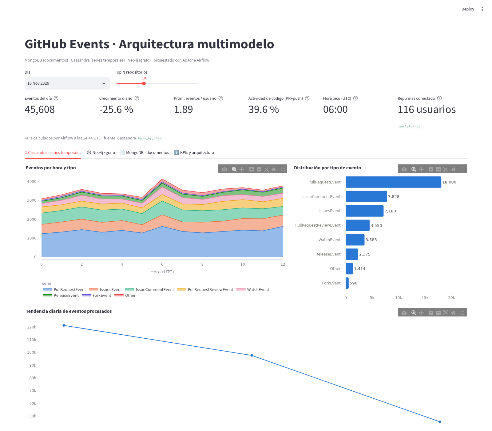

# Arquitectura multimodelo para eventos de GitHub

Proyecto Grupal II del curso de Big Data (UTEC).

Integrantes: Percy Castro, Jorge Martínez, Carla Molina, Leonardo Montesinos y Yitzhak Namihas.

## ¿Qué hace el proyecto?

Cada hora el sistema descarga los eventos públicos de GitHub que publica GH Archive
(un archivo JSON comprimido por hora) y los reparte en tres bases NoSQL según el tipo de dato.
Un DAG de Apache Airflow orquesta todo el flujo y un dashboard en Streamlit lee las tres bases.

El objetivo es analizar la actividad de usuarios y repositorios combinando documentos,
series temporales y relaciones de grafo. Los notebooks incluyen operaciones CRUD
(crear, leer, actualizar y eliminar) para cada base de datos.

Al cierre del informe se habían procesado 1 056 archivos horarios (del 1 de octubre al 13 de
noviembre de 2026), equivalentes a 31,6 millones de eventos.



Captura incluida en el informe. Los valores corresponden a ese momento de la carga.

## ¿Cómo funciona?

```
GH Archive (un .json.gz por hora)
        |
        v
Airflow: DAG github_events_pipeline, cada hora
        |
        |  0. recover_missing_hours     repone horas recientes que no se cargaron
        |  1. extract_data              descarga el archivo de la hora
        |  2. validate_and_clean        valida, quita duplicados, recorta el payload
        |  3. load_mongodb              --> MongoDB    evento original
        |  4. transform_load_cassandra  --> Cassandra  agregados por hora y por día
        |  5. build_graph_neo4j         --> Neo4j      grafo usuario -> repo -> organización
        |  6. generate_kpis             --> Cassandra  5 KPIs del día
        v
Dashboard Streamlit y notebooks de CRUD
```

Las tres bases forman una cadena, no tres cargas paralelas: la etapa 4 lee los eventos de
MongoDB y la etapa 5 lee las interacciones de Cassandra. Cada capa se puede reconstruir desde
la anterior.

La limpieza valida los campos obligatorios, elimina eventos duplicados por identificador
y conserva los campos del `payload` utilizados en el análisis. Las fechas se procesan en
UTC; para interpretarlas en Lima, se restan cinco horas.

### ¿Por qué se utiliza una base de datos para cada tipo de información?

| Base | Qué guarda | Por qué |
|---|---|---|
| MongoDB | El evento original | El campo `payload` cambia de forma según el tipo de evento; un documento lo admite sin esquema fijo. |
| Cassandra | Conteos por hora y día, KPIs, registro de corridas | Series temporales: se escribe mucho y se lee por rango de fechas. Cada tabla responde una consulta del dashboard. |
| Neo4j | Usuarios, repositorios y organizaciones con sus relaciones | Preguntas como «¿Qué repositorio conecta a más usuarios?» se resuelven mediante recorridos de grafo. |

Decisiones de diseño que conviene conocer:

- **Carga incremental.** Cada corrida procesa una sola hora nueva.
- **Idempotencia.** MongoDB usa el id del evento como `_id`, Cassandra escribe valores absolutos
  y Neo4j omite las horas ya cargadas. Repetir una hora no duplica nada.
- **Recuperación.** La tabla `pipeline_runs` registra cada hora procesada. Si Airflow estuvo
  detenido o una corrida falló, la tarea 0 detecta el hueco y lo repone.
  Por defecto, revisa las últimas 72 horas y recupera hasta seis por ejecución; estos límites
  se ajustan en `.env`.

## Indicadores

| KPI | Definición | Fuente |
|---|---|---|
| `events_per_day` | Eventos procesados en el día | Cassandra |
| `daily_growth_pct` | Variación de los tipos estables frente al día anterior, sobre las horas cargadas en ambos días | Cassandra |
| `avg_events_per_user` | Eventos por usuario único | Cassandra |
| `pr_merge_rate_pct` | Porcentaje de pull requests fusionados entre los cerrados del día | MongoDB |
| `top_repo_connections` | Repositorio con más usuarios distintos conectados hasta el final del día | Neo4j |

Las fórmulas y su interpretación están en el informe y en cada ficha del dashboard.
Para comparar días, se debe revisar cuántas horas se han cargado. El crecimiento diario
excluye `PushEvent`, `CreateEvent` y `DeleteEvent`, cuya cobertura es intermitente en los datos
utilizados; si falta la base de comparación, se muestra como no disponible.

## Guía de uso

Requisitos: Docker con Compose y unos 12 GB de RAM libres.
Los comandos siguientes se ejecutan desde la raíz del repositorio en Bash (Linux, macOS o
WSL en Windows). El archivo `.env` contiene la configuración local de las bases y del pipeline.
Para Windows con PowerShell, utiliza el bloque alternativo de abajo. Copia `.env.example`
solo en una instalación nueva; conserva tu `.env` si ya configuraste el proyecto.

### Inicio desde Bash o WSL

```bash
cp .env.example .env
mkdir -p data/raw data/processed && chmod -R a+rwX data

docker compose build
docker compose up -d
docker compose ps -a          # bases healthy; airflow-init termina con Exited (0)

# esquemas de las tres bases
docker exec -i cassandra cqlsh < scripts/init_cassandra.cql
docker compose exec -T jupyter python scripts/init_mongo.py
docker compose exec -T jupyter python scripts/init_neo4j.py

# primera carga: la hora más reciente publicada
docker compose exec -T jupyter bash -c 'cd src && python run_pipeline_local.py'
```

### Inicio desde PowerShell

Abre Docker Desktop con el motor de contenedores Linux activo y ejecuta estos comandos
desde la raíz del repositorio. `cqlsh -f` lee el archivo montado dentro de Cassandra y
evita depender de la redirección `<` de Bash.

```powershell
if (-not (Test-Path -LiteralPath .env)) {
    Copy-Item -LiteralPath .env.example -Destination .env
}
New-Item -ItemType Directory -Force -Path data/raw, data/processed | Out-Null

docker compose build
docker compose up -d
docker compose ps -a

# Esperar a que las bases estén healthy y airflow-init termine con Exited (0).
docker compose exec -T cassandra cqlsh -f /scripts/init_cassandra.cql
docker compose exec -T jupyter python scripts/init_mongo.py
docker compose exec -T jupyter python scripts/init_neo4j.py

# Primera carga: la hora más reciente publicada.
docker compose exec -T jupyter python src/run_pipeline_local.py
```

En Airflow, verifica que el DAG `github_events_pipeline` esté activo. Desde ese momento,
carga una hora nueva cada hora sin intervención. Se aplica un retraso de publicación de
dos horas (`GHARCHIVE_LAG_HOURS=2`) antes de solicitar el archivo a GH Archive.

Para cargar días anteriores:

```bash
# un día completo
docker compose exec -T jupyter python src/run_pipeline_local.py 2026-11-09 0 23

# el rango definido en .env (BACKFILL_START_DATE y BACKFILL_END_DATE)
docker compose exec -T jupyter python scripts/backfill_days.py --parallel 3
```

Estos dos comandos de carga histórica también funcionan en PowerShell.

Servicios una vez levantado el stack:

| Servicio | Dirección | Acceso |
|---|---|---|
| Dashboard | http://localhost:8501 | libre |
| Airflow | http://localhost:8080 | admin / admin |
| Jupyter | http://localhost:8888 | token `bigdata` |
| Neo4j Browser | http://localhost:7474 | neo4j / `NEO4J_PASSWORD` del `.env` |
| Mongo Express | http://localhost:8081 | libre |
| Cassandra Web | http://localhost:8083 | solo lectura |

Para desplegarlo en Google Cloud están los scripts de `gcp/` y el paso a paso en `gcp/MANUAL.md`.

### Configuración de referencia

Los siguientes valores provienen de [`.env.example`](.env.example). Los límites de carga,
recuperación y retención afectan al pipeline. Las opciones visuales del dashboard se
ajustan en la propia página.

| Variable | Valor de ejemplo | Uso |
|---|---|---|
| `MONGO_URI` | `mongodb://localhost:27017` | Conexión a MongoDB desde el equipo anfitrión. |
| `MONGO_DB` | `github_events` | Base de datos de eventos. |
| `CASSANDRA_HOST` | `localhost` | Servidor Cassandra desde el equipo anfitrión. |
| `CASSANDRA_KEYSPACE` | `github_metrics` | Espacio de tablas de agregados y KPIs. |
| `NEO4J_URI` | `bolt://localhost:7687` | Conexión Bolt desde el equipo anfitrión. |
| `NEO4J_USER` | `neo4j` | Usuario de Neo4j. |
| `NEO4J_PASSWORD` | `bigdata2026` | Contraseña inicial, aplicada al crear el volumen. |
| `NEO4J_DATABASE` | `neo4j` | Base de datos del grafo. |
| `MAX_EVENTS_PER_RUN` | `200000` | Máximo de eventos válidos por carga horaria; sigue siendo un límite numérico. |
| `GHARCHIVE_LAG_HOURS` | `2` | Retraso en horas antes de solicitar un archivo a GH Archive. |
| `RECOVERY_WINDOW_HOURS` | `72` | Ventana de horas recientes en la que se buscan cargas faltantes. |
| `RECOVERY_MAX_HOURS` | `6` | Máximo de horas que se recuperan por ejecución; `0` desactiva la recuperación. |
| `BACKFILL_START_DATE` | `2026-10-01` | Primera fecha de la carga histórica, incluida. |
| `BACKFILL_END_DATE` | vacío | Última fecha, incluida; vacío utiliza el día actual en UTC. |
| `MONGO_RETENTION_HOURS` | `0` | Retención en horas; `0` desactiva el borrado por antigüedad. |
| `NEO4J_RETENTION_HOURS` | `0` | Antigüedad para podar usuarios inactivos; `0` desactiva la poda. |
| `NEO4J_TOP_REPOS` | `10000` | Máximo de repositorios por lote que entran en las interacciones del grafo. |
| `NEO4J_TOP_USERS` | `20000` | Máximo de usuarios por lote que entran en las interacciones del grafo. |
| `AIRFLOW_ADMIN_USER` | `admin` | Usuario creado al inicializar Airflow. |
| `AIRFLOW_ADMIN_PASSWORD` | `admin` | Contraseña inicial de Airflow. |
| `AIRFLOW_UID` | `50000` | Valor de referencia incluido en el ejemplo; el Compose actual no lo usa para definir `user`. |
| `JUPYTER_TOKEN` | `bigdata` | Token de acceso a Jupyter. |

Dentro de Docker, el bloque `x-db-env` de [`docker-compose.yml`](docker-compose.yml)
establece las conexiones entre servicios: `mongo`, `cassandra` y `neo4j`, además del
usuario y la base `neo4j`. Las URI con `localhost` del ejemplo sirven para ejecutar
código desde el equipo anfitrión. Si falta `MAX_EVENTS_PER_RUN` en el entorno,
`src/config.py` utiliza `60000`, aunque el archivo de ejemplo propone `200000`.

### ¿Cómo se consulta el dashboard?

Abre http://localhost:8501, selecciona la fecha de análisis y ajusta la cantidad de elementos
en los rankings. Las pestañas permiten consultar los resultados de cada base de datos y las
fichas explican la definición, fórmula e interpretación de los cinco indicadores.

- **Apariencia:** el interruptor «Modo oscuro», junto a los filtros, permite alternar entre
  el tema oscuro y el claro original.
- **Zoom:** usa la rueda del ratón o arrastra sobre una gráfica para ampliar una zona. Al
  pasar el cursor aparecen los controles para acercar, alejar y desplazar la vista. Un doble
  clic o el botón de restablecer devuelve la escala inicial.
- **Descargas CSV:** el botón situado bajo las tarjetas exporta los cinco KPI de la fecha
  seleccionada, usando los mismos valores que muestra el dashboard, incluido el crecimiento
  recalculado. En Cassandra puedes descargar los conteos horarios por tipo de evento y los
  rankings visibles. Los CSV de rankings respetan la búsqueda y conservan las posiciones
  originales. Los archivos usan UTF-8 con BOM para conservar las tildes al abrirlos en Excel.
- **Búsqueda en rankings:** los campos de repositorio y usuario filtran por parte del nombre,
  sin distinguir mayúsculas. Buscan dentro del ranking mostrado en la pestaña Cassandra;
  el contador indica cuántas filas coinciden. Borra el texto para recuperar el ranking completo.
- **Mapa de calor:** abre «Mapa de calor por día y hora» en la pestaña Cassandra. Puedes ver
  los últimos 7, 14 o 30 días, o todo el periodo hasta la fecha seleccionada. Cada celda muestra
  los eventos de una hora en UTC. El gris señala horas sin datos; el color inicial de la escala
  representa cero eventos. El mapa incluye todos los tipos de evento, por lo que también
  refleja los cambios de cobertura del feed.
- **Enlaces a GitHub:** los nombres válidos de repositorios y usuarios en las tablas abren
  su página en una pestaña nueva. Las cuentas con sufijo `[bot]` se conservan como texto,
  porque ese identificador no garantiza un perfil público navegable.
- **Rankings del grafo:** en Neo4j puedes descargar el ranking de repositorios y los usuarios
  del vecindario mostrado. Estos CSV indican que su alcance es el grafo acumulado de todas
  las fechas; la fecha de análisis incluida no limita ese grafo.

Estas opciones solo cambian la visualización; los datos, indicadores y filtros de análisis
se mantienen.

### Aplicación conectada e instantánea HTML

| Versión | Cómo abrirla | Datos y funciones |
|---|---|---|
| [`dashboard/app.py`](dashboard/app.py) | http://localhost:8501 con el stack activo | Aplicación Streamlit que consulta las tres bases. Incluye las descargas, búsquedas y el mapa de calor descritos arriba. |
| [`dashboard/dashboard.html`](dashboard/dashboard.html) | Abrir el archivo en un navegador | Instantánea autónoma con datos incorporados, generada el 13 de noviembre de 2026 (UTC). Permite explorar esa captura sin levantar las bases; sus datos y funciones corresponden a la versión exportada. |

La instantánea HTML no se regenera al ejecutar Airflow ni al cambiar la aplicación Streamlit.
En Streamlit, las consultas utilizan una caché de cinco minutos, o diez minutos para el ranking
de repositorios de Cassandra. Un nuevo cálculo del pipeline puede tardar ese intervalo en verse
al volver a consultar la página. La cabecera muestra el último dato cargado y, bajo las tarjetas,
la fecha del último cálculo guardado de los KPI.

### Problemas frecuentes

| Síntoma | Qué revisar |
|---|---|
| Docker no conecta o informa de un motor inexistente | Abrir Docker Desktop, activar el motor Linux y comprobar `docker info`. |
| El dashboard muestra «Aún no hay datos» | Revisar los esquemas y ejecutar la primera carga de la guía. Confirmar que el DAG `github_events_pipeline` está activo. |
| No se puede conectar a Cassandra, MongoDB o Neo4j | Consultar `docker compose ps -a` y los logs. Esperar a que las bases estén `healthy`; comprobar las conexiones de `x-db-env`. |
| Neo4j rechaza la contraseña después de editar `.env` | La contraseña inicial se aplica cuando se crea el volumen. Conservar las credenciales vigentes o cambiarlas desde Neo4j; editar `.env` no cambia la contraseña almacenada. |
| Aparecen días parciales o crecimiento `N/D` | Revisar las horas cargadas en «Metodología y calidad de datos». El crecimiento necesita horas comunes y una base de comparación mayor que cero en el día anterior. |
| No aparecen inmediatamente los datos nuevos | Revisar el último dato cargado, el cálculo de los KPI y los intervalos de caché indicados arriba; volver a consultar al vencer la caché. |
| Una búsqueda no devuelve resultados | Solo abarca el ranking visible. Borrar la búsqueda o ajustar el periodo, el criterio y la cantidad de repositorios del ranking. |

Diagnóstico desde Bash o PowerShell:

```bash
docker info
docker compose ps -a
docker compose logs --tail=100 dashboard cassandra mongo neo4j airflow-scheduler
```

## Estructura del repositorio

```
dags/        DAG de Airflow
src/         una etapa del pipeline por archivo, más config, KPIs y recuperación
scripts/     creación de esquemas y utilidades de carga histórica
notebooks/   exploración del dataset, CRUD en cada base y KPIs
dashboard/   aplicación Streamlit e instantánea HTML autónoma
docker/      imágenes de Airflow, Jupyter y dashboard
gcp/         despliegue en Google Cloud
informe/     informe técnico en LaTeX y PDF
```
